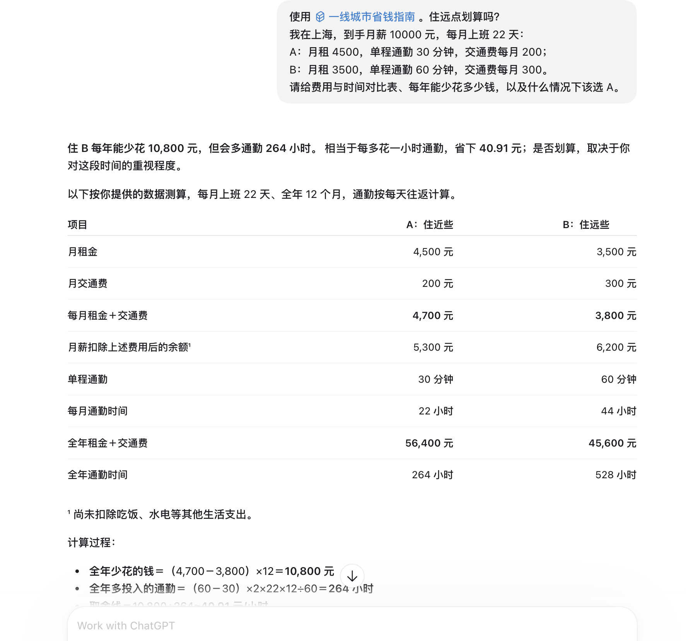

# 给 Claude Code / Codex 装一个会算账的省钱大脑

**问一句「住远点划算吗」，让它把房租、交通费、通勤时间排成对比表。**

## 一键安装

按你使用的工具选择一条命令即可（macOS / Linux / Git Bash，需要 Git；在没有 `HowToSaveMoney` 同名目录的位置执行）。已有同名 Skill 时先备份，避免覆盖自己的修改。

### Claude Code

```bash
git clone https://github.com/sluke23/HowToSaveMoney.git && mkdir -p "$HOME/.claude/skills" && cp -R HowToSaveMoney/skills/save-money-guide "$HOME/.claude/skills/"
```

安装后打开新会话，用 `/save-money-guide` 调用。

### Codex

```bash
git clone https://github.com/sluke23/HowToSaveMoney.git && mkdir -p "${CODEX_HOME:-$HOME/.codex}/skills" && cp -R HowToSaveMoney/skills/save-money-guide "${CODEX_HOME:-$HOME/.codex}/skills/"
```

安装后打开新会话，用 `$save-money-guide` 调用。

仓库已下载，或需要 WorkBuddy / Windows 安装方法，见[完整安装说明](docs/使用省钱指南Skill.md#安装)。

## 对话示例

安装后打开新会话，复制下面的问题：

```text
使用 $save-money-guide。住远点划算吗？
我在上海，到手月薪 10000 元，每月上班 22 天：
A：月租 4500，单程通勤 30 分钟，交通费每月 200；
B：月租 3500，单程通勤 60 分钟，交通费每月 300。
请给费用与时间对比表、每年能少花多少钱，以及什么情况下该选 A。
```

Claude Code 将 `$save-money-guide` 换为 `/save-money-guide`。

<p align="center">
  <a href="docs/images/skill-rent-comparison.png">
    
  </a>
</p>

*Codex 实际对话截图，点击查看原图。具体回答随模型与输入而变化。*

| 你问 | 它帮你做什么 |
| --- | --- |
| 住远点划算吗？ | 对比现金支出与通勤投入，算出买回一小时的价格 |
| 每月存不下钱，先改哪三笔？ | 按固定支出、时间成本与执行条件排优先级 |
| 我在深圳，有哪些待遇值得查？ | 列出需核对条件的事项、章节出处和官方入口，区分补贴、退税与账户提取 |

Skill 内置《一线城市省钱指南》的 **17 章、94 节、3 个附录和待核实清单**，按问题读取相关资料，给出可复算的比较与章节出处。支持北京、上海、广州、深圳；资料基线为 2026 年 10 月，当前政策需另查官方规则。文件可离线查阅；运行它仍需要支持 Skill 的 AI 助手。

作者：**毛毛&luke**。正文与工具内容继续遵循[原有混合许可](LICENSE)。

[安装与使用](docs/使用省钱指南Skill.md) · [查看 Skill](skills/save-money-guide/SKILL.md) · [在线阅读与时薪计算器](https://sluke23.github.io/HowToSaveMoney/) · [完整目录](#目录)

## 也可以直接读指南

[开始阅读](book/00-这本书怎么用.md) · [按问题查阅](#按问题查阅) · [静态阅读页](index.html) · [EPUB / PDF 等阅读格式](tools/README.md) · [参与完善](CONTRIBUTING.md)

## 这份指南想做什么

房租、吃饭、通勤、通信、医保、购物，以及那些需要自己去申请的政策待遇，构成了一线城市生活的大部分成本。这份指南把它们拆开讲：哪些费用可以谈，哪些公共资源可以用，哪些申领入口值得先查，哪些坑会让前面的节省全部归零。

写给在北上广深工作、月收入约 6000–30000 元的普通人，尤其是刚来一线城市、收入涨了却存不下钱，以及正在决定留下还是离开的人。按自己的需要选一两项开始，不必一次做完。

本项目延续 [高性价比人生指南 HowToLiveBetter](https://github.com/eternity4719/HowToLiveBetter) 的思路，参考其“README 总览、book 分章正文、docs 补充材料、静态检索”的组织方式。正文来源于毛毛&luke提供的《一线城市省钱指南 v1.0（合规修订版）》PDF；致谢与来源见[整理说明](docs/整理说明.md)。

## 怎么读

- **只有 30 分钟**：先看[第八章：制度性收入](book/08-制度性收入.md)和[第十三章：防守](book/13-防守.md)。
- **准备换房**：先看[第一章：住处](book/01-住处.md)，再看所在城市的专章。
- **想系统降本**：按第一至八章顺序读，先处理房租、话费、宽带、订阅等固定支出。
- **准备买房、买车或孩子入学**：查看第十四至十六章，先把条件、总成本和办理时间列出来。
- **想直接找办理入口**：看各节“本节相关链接”，或打开[附录 B：链接索引](docs/附录B-链接索引.md)。

## 按问题查阅

| 我现在遇到的问题 | 从这里开始 |
| --- | --- |
| 住远一点到底划不划算？看房、合同怎么检查？ | [住处](book/01-住处.md) |
| 不想天天外卖，怎样省钱又吃好？ | [吃饭](book/02-吃饭.md) |
| 地铁折扣、公交、P+R，哪种适合我的通勤？ | [出行](book/03-出行.md) |
| 话费宽带太贵，自动续费总是忘关？ | [水电气网与话费](book/04-水电气网与话费.md) |
| 医保、社区门诊和公共健康资源怎么用？ | [医疗与健康](book/05-医疗与健康.md) |
| 二手、大促、会员卡，怎样判断真便宜？ | [购物](book/06-购物.md) |
| 免费图书馆、展览、夜校和语言学习去哪找？ | [精神生活](book/07-精神生活.md) |
| 个税、公积金、失业金和技能补贴怎么查？ | [制度性收入](book/08-制度性收入.md) |
| 北上广深各有什么特别的省钱办法？ | [北京](book/09-北京.md) · [上海](book/10-上海.md) · [广州](book/11-广州.md) · [深圳](book/12-深圳.md) |
| 押金、预付卡、借贷和副业，怎么避免亏一大笔？ | [防守](book/13-防守.md) |
| 买房、买车、孩子上学和储蓄，该先算什么？ | [买房](book/14-买房.md) · [买车](book/15-买车.md) · [孩子上学](book/16-孩子上学.md) · [理财](book/17-理财.md) |

## 三条原则

1. **降低单位体验成本**：把价格、使用次数、时间和风险放在一起算。
2. **先优化固定支出**：一次谈好房租、改好套餐，收益能持续发生。
3. **先查政策与公共资源**：知道入口、符合条件、如实申报，再考虑花钱解决。

书中案例和节省金额用于理解方法，不能直接相加当作个人预算。公积金提取是使用已有个人账户资金，专项附加扣除是减少应纳税所得额，两者都不等同于新增现金补贴。

## 目录


### 使用说明

- [这本书怎么用](book/00-这本书怎么用.md)

### 第一部 活下去：压住四笔最大支出

- [第一章 住处：一间房的价格构成](book/01-住处.md)
- [第二章 吃饭：把“消费”改回“生产”](book/02-吃饭.md)
- [第三章 出行：通勤是可以“套利”的](book/03-出行.md)
- [第四章 水、电、气、网、话费：把固定支出压到地板](book/04-水电气网与话费.md)

### 第二部 生活：让每一块钱花出两块钱的效果

- [第五章 医疗与健康：别在小病上花大钱](book/05-医疗与健康.md)
- [第六章 购物：从“买新的”到“买对的”](book/06-购物.md)
- [第七章 精神生活：一线城市最贵的东西，很多是免费的](book/07-精神生活.md)

### 第三部 制度：城市每年发给你的几千块

- [第八章 制度性收入：城市每年发给你的几千块](book/08-制度性收入.md)

### 第四部 城市：四座城市各自的省法

- [第九章 北京：把“通勤半径”换成“租金差”](book/09-北京.md)
- [第十章 上海：把“保租房”当成第一选项](book/10-上海.md)
- [第十一章 广州：一线城市里生活成本相对低的一座](book/11-广州.md)
- [第十二章 深圳：先申请保租房，再谈房租](book/12-深圳.md)

### 第五部 防守：别先亏掉一笔大的

- [第十三章 防守：别先亏掉一笔大的](book/13-防守.md)

### 第六部 资产：成熟打工人的四笔大钱

- [第十四章 买房：利率、税费与中介费](book/14-买房.md)
- [第十五章 买车：补贴、牌照与用车成本](book/15-买车.md)
- [第十六章 孩子上学：规则搞清了，钱能省一半](book/16-孩子上学.md)
- [第十七章 理财：省下来的钱怎么打理](book/17-理财.md)

### 附录

- [附录A 一年省钱日历](docs/附录A-一年省钱日历.md)
- [附录B 链接索引](docs/附录B-链接索引.md)
- [附录C 政策文号核对清单](docs/附录C-政策文号核对清单.md)

## 阅读页与本地使用

仓库自带 [index.html](index.html)，支持全文搜索、按城市和章节筛选、章节直达以及手机阅读。网页已内嵌全文，无外部脚本依赖；下载整个仓库后，双击即可离线阅读。GitHub 文件预览不会运行 HTML，可下载后打开，或按下面方式本地浏览。

```bash
python3 -m http.server 8000
```

浏览器打开 `http://localhost:8000/`。将仓库推送到 GitHub 后，可在 **Settings → Pages → Deploy from a branch** 选择对应分支的根目录 `/ (root)` 发布阅读页。

正文以 `book/` 和 `docs/` 的 Markdown 为维护源。修改后重新生成阅读页：

```bash
python3 -m pip install -r tools/requirements.txt
python3 tools/build_site.py
python3 tools/build_skill.py
python3 tools/check.py
```

## 导出到阅读器

`tools/` 提供 EPUB 3、PDF、离线单文件 HTML 和 UTF-8 TXT 导出，统一从当前 Markdown 生成，保留作者署名、混合许可及待核实说明。原始 PDF 已不随仓库提供；如需 PDF，请使用导出工具或下载 GitHub Actions 构建产物。

```bash
python3 -m pip install -r tools/requirements-export.txt
python3 tools/export_book.py
python3 tools/check_exports.py
```

产物位于 `dist/`；PDF 需要中文 TrueType 字体。完整安装、字体、各格式特性和 GitHub Actions 下载方法见 [阅读工具与构建](tools/README.md)。

## 内容时效与来源

正文和政策金额沿用 PDF **v1.0（2026 年 10 月）**口径；仓库整理日期为 **2026 年 11 月 8 日**，不表示所有政策在该日已重新核验。原 PDF 中的人工智能辅助生成说明、免责声明与许可已保留在[版权与使用说明](docs/版权与使用说明.md)。涉及申领、报销、资格认定，以主管部门最新公告为准。

原 PDF 页码的历史对应关系见[内容映射](docs/内容映射.json)。[附录 C](docs/附录C-政策文号核对清单.md)中的核对结论来自原文，不代表本次整理新增的核验。当前需进一步核实的具体问题见[待核实清单](docs/待核实清单.md)。

## 参与完善

欢迎提交错别字、失效链接、政策变更和本地经验。请写清**城市、适用人群、时间、对应章节和官方来源**；经验与正式政策应区分标注。具体步骤见 [CONTRIBUTING.md](CONTRIBUTING.md)，版本变化见 [CHANGELOG.md](CHANGELOG.md)。

## 许可与致谢

沿用原 PDF 的混合许可：一般正文、表格与测算采用 **CC BY-NC-SA 4.0**；1.3 看房清单、1.4 合同四句话、13.6 维权工具箱及附录 A 日历采用 **CC BY 4.0**；书名、英文副题与原封面版式保留全部权利。具体范围与协议链接见 [LICENSE](LICENSE)。

感谢 [eternity4719/HowToLiveBetter](https://github.com/eternity4719/HowToLiveBetter) 提供的项目思路与组织参考。

## Star 趋势

[](https://star-history.com/#sluke23/HowToSaveMoney&Date)
